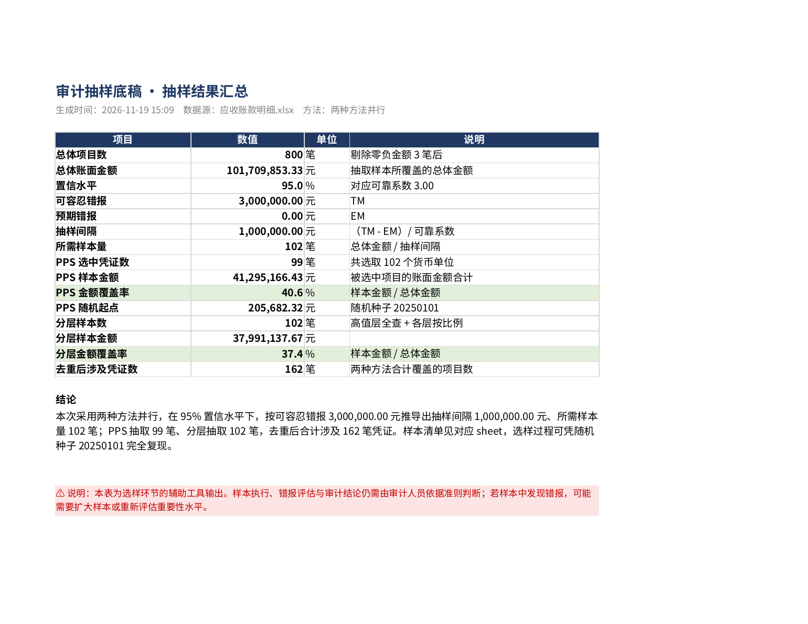
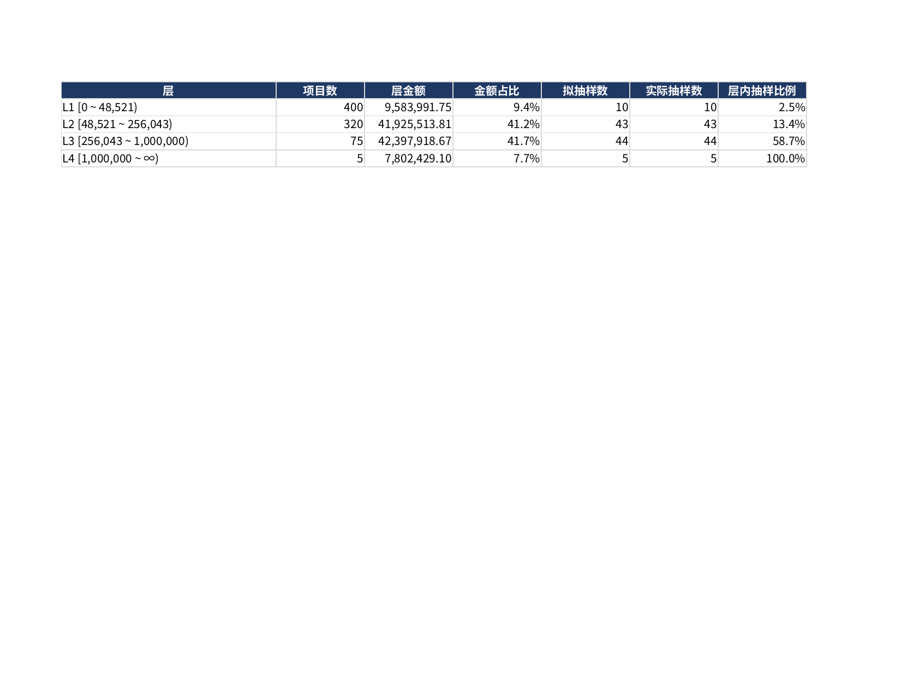
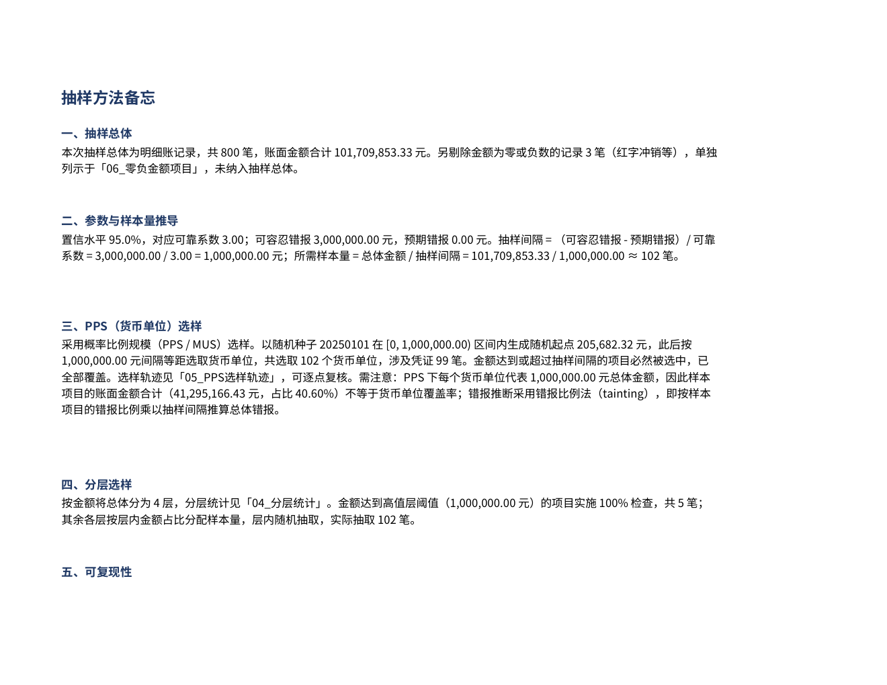

# 审计抽样工具（audit-sampling）

按 MUS 公式推导样本量，支持 **PPS（货币单位）选样** 和 **分层抽样**，输出可直接放进底稿的 Excel，并且**同样的参数永远跑出同样的样本**。



---

## 一、为什么不能"随机抽 30 个"

审计抽样不是从表里随便点几行。样本量由三个参数决定：**置信水平、可容忍错报、预期错报**。少了这一步，抽多少都说不清依据，底稿复核时第一句就会被问住。

这个工具把这套推导固化下来：

```
抽样间隔 = （可容忍错报 - 预期错报）/ 可靠系数
所需样本量 = 总体金额 / 抽样间隔
```

可靠系数按置信水平查表（AICPA 审计抽样指南常用值）：

| 置信水平 | 99% | 95% | 90% | 80% | 50% |
| --- | --- | --- | --- | --- | --- |
| 可靠系数 | 4.61 | 3.00 | 2.31 | 1.61 | 0.70 |

例：总体 1.017 亿、可容忍错报 300 万、预期错报 0、置信 95%
→ 间隔 = 300万 / 3.00 = 100 万 → 样本量 = 1.017亿 / 100万 ≈ 102 笔。

## 二、两种选样方法

### PPS / MUS（货币单位选样）

**原理**：把整个总体看成一条由"元"铺成的长带子，每隔一个抽样间隔取一个货币单位，货币单位落在哪笔凭证的区间里，那笔凭证就入选。

- 金额越大的项目被选中的概率越高（概率 ≈ 金额 / 间隔），这正是审计想要的
- 金额 ≥ 抽样间隔的项目必然被选中，高值项自动全覆盖
- 选样结果带完整轨迹（第几个货币单位、命中哪张凭证、原表第几行），可以逐点复核


### 分层抽样

按金额把总体切成若干层（默认 4 层，也可自定义边界）：

- **最高层（≥ 高值阈值）100% 检查**，不留抽样风险
- 其余各层按**层金额占比**分配样本量，层内随机抽取
- 输出每层的项目数、层金额、金额占比、实际抽样数、层内抽样比例



## 三、快速开始

```bash
cd audit-sampling-tool
pip install -r requirements.txt

# 生成模拟总体（800 笔应收账款，含 3 笔红字冲销）
python sample_data/generate_sample.py

# 两种方法一起跑
python run.py --data sample_data/应收账款明细.xlsx \
              --method both \
              --confidence 95 \
              --tolerable 3000000 \
              --expected 0 \
              --out output/抽样结果.xlsx
```

输出：

```
可靠系数 3.00，抽样间隔 1,000,000.00 元，所需样本量 102 笔
PPS：选中 99 笔 / 货币单位 102 个，样本金额 41,295,166.43 元，覆盖率 40.60%
分层：抽取 102 笔，样本金额 37,991,137.67 元，覆盖率 37.35%
两种方法合计涉及凭证 162 笔（去重）
耗时 0.18 秒
```

### 参数

| 参数 | 默认 | 说明 |
| --- | --- | --- |
| `--data` | 必填 | 总体明细（xlsx / xls / csv） |
| `--method` | `both` | `pps` / `stratified` / `both` |
| `--confidence` | 95 | 置信水平，自动匹配最近档位 |
| `--tolerable` | 取 `--materiality` | 可容忍错报 TM |
| `--materiality` | 无 | 整体重要性水平 |
| `--expected` | 0 | 预期错报 EM |
| `--seed` | 20250101 | 随机种子，决定选样结果 |
| `--top-layer` | 抽样间隔 | 分层时的全查阈值 |
| `--strata` | 自动分位 | 分层边界，如 `0,50000,300000,1000000` |

列名同样自动识别（凭证号/单据号、记账日期、摘要、对方单位、借方金额/金额）。

## 四、输出底稿（7 张 sheet）

| Sheet | 内容 |
| --- | --- |
| `01_抽样汇总` | 总体、参数、样本量推导、样本指标、结论 |
| `02_样本清单_PPS` | 选中凭证、命中次数、选中概率、入选理由 |
| `03_样本清单_分层` | 选中凭证、所属层、层内抽样比例 |
| `04_分层统计` | 各层项目数、层金额、占比、抽样数 |
| `05_PPS选样轨迹` | 每个货币单位的位置、命中凭证、原表行号 |
| `06_零负金额项目` | 红字冲销等，单独列示不纳入总体 |
| `07_抽样方法备忘` | 可直接写进底稿的方法说明（见下图） |



备忘这一页是刻意做的：抽样底稿里"怎么抽的、为什么这么抽"往往比样本清单本身更容易被复核挑问题。这里把总体口径、公式、间隔、起点、种子、可复现命令全部写死。

## 五、可复现

同一个 `--seed` + 同一批参数，样本清单**逐笔一致**。这一点在审计里不是加分项，是必需品——复核人说"你重新跑一遍给我看"，你得跑得出一样的结果。

```bash
# 换种子 = 换一套样本（用于扩大样本或重新选样）
python run.py --data ... --seed 20250102
```

## 六、几个专业细节

**样本项目的账面金额合计 ≠ 覆盖率。** PPS 下每个货币单位代表一整个间隔的金额，102 个货币单位覆盖的就是全部总体金额；输出里那个 40.6% 是"被选中凭证的账面金额占比"，不是抽样覆盖率。错报推断用**错报比例法（tainting）**：某项目错报 3 万、项目金额 10 万，则错报比例 30%，推算到总体时按 30% × 间隔。

**高值层与 PPS 的自动覆盖。** 两者都会 100% 覆盖金额 ≥ 阈值的项目，这是特性不是巧合——大额项目本来就不该靠运气抽到。

**零负金额单独列示。** 红字冲销不进入抽样总体（否则会稀释货币单位），单独列一张表提示审计人员评估其性质。

## 七、已知局限

1. **只做选样**：样本执行、错报汇总、推断与结论仍需人工完成，工具不代替判断。
2. **不含属性抽样**：控制测试用的属性抽样（预期偏差率 / 可接受偏差率）没有实现，这是另一套公式。
3. **分层分配是"按金额占比"**：未实现 Neyman 最优分配（按层内标准差分配）。如果客户各层金额离散度差异极大，可以手工传 `--strata` 并调整参数。
4. **不支持合并凭证**：一张凭证对应多笔业务时按单条记录处理。
5. **高值阈值默认等于抽样间隔**：实务中也可按重要性水平或可容忍错报设定，用 `--top-layer` 覆盖。

## 八、技术栈

Python 3.10+ / pandas / numpy / openpyxl。无第三方抽样库，公式与算法全部显式实现，便于复核。

---

**数据说明**：`sample_data/应收账款明细.xlsx` 由脚本随机生成，公司名与金额均为虚构，不含任何真实客户信息。
